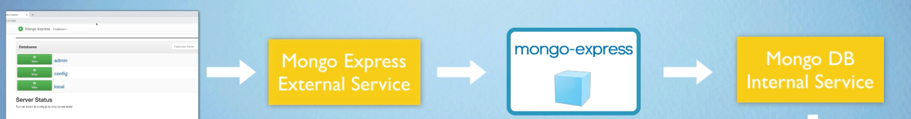
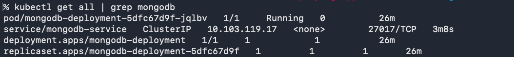
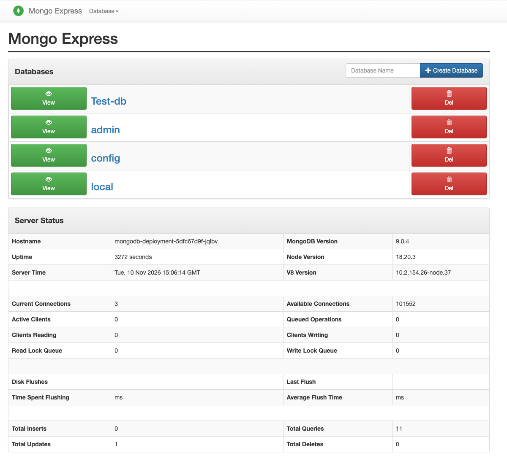
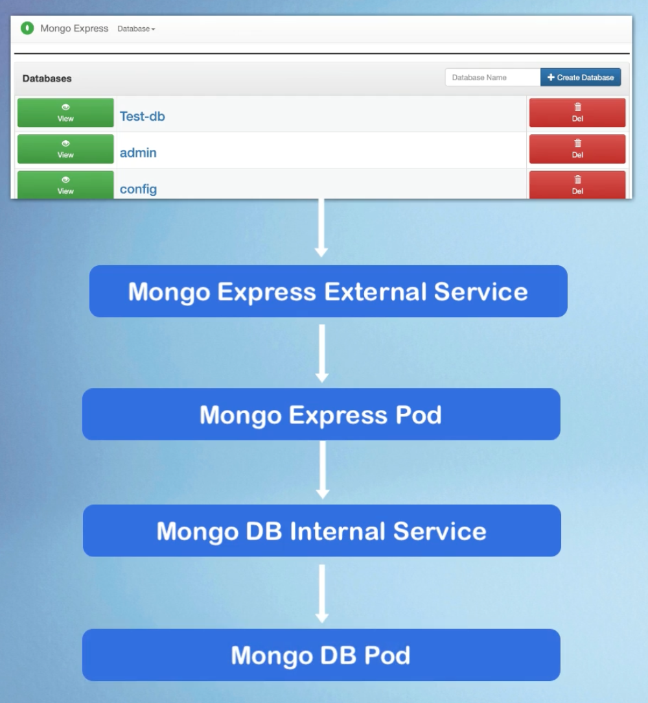

# Deploy MongoDB and Mongo Express into local K8s cluster

A demo project in which I deploy a MongoDB database and the Mongo Express web UI into a local Kubernetes cluster running on Minikube. The database URL lives in a ConfigMap and the database credentials live in a Secret, so neither is hardcoded in the deployment files.

 

_Request flow: browser → Mongo Express external service → Mongo Express pod → MongoDB internal service_

 

## Technologies used

Kubernetes, Docker, MongoDB, Mongo Express, Minikube

 

## Project description

- Set up a local K8s cluster with Minikube
- Deployed MongoDB and Mongo Express, with configuration and credentials extracted into a ConfigMap and a Secret

 

## What I did

### 1. Created the Secret

[mongo-secret.yaml](mongo-secret.yaml) holds the MongoDB root username and password as base64-encoded values. MongoDB and Mongo Express both read them from here.

 

### 2. Deployed MongoDB with an internal Service

[mongo.yaml](mongo.yaml) defines the MongoDB Deployment, which reads its root credentials from the Secret. It also defines `mongodb-service`, a ClusterIP Service on port 27017. That Service is only reachable from inside the cluster.

 

_`kubectl get all | grep mongodb`: the MongoDB pod, service, deployment and replica set are all up and running_

 

### 3. Created the ConfigMap

[mongo-configmap.yaml](mongo-configmap.yaml) stores the database address (`mongodb-service:27017`), so Mongo Express can find MongoDB by its Service name.

 

### 4. Deployed Mongo Express with an external Service

[mongo-express.yaml](mongo-express.yaml) defines the Mongo Express Deployment. It builds its connection string from the Secret (username and password) and the ConfigMap (database URL). It also defines `mongo-express-service`, a LoadBalancer Service on nodePort 30000 that exposes the UI outside the cluster.

 

### 5. Accessed Mongo Express from the browser

Minikube doesn't assign an external IP to LoadBalancer Services, so I used `minikube service` to open a tunnel to the UI.

 

_`minikube service mongo-express-service` opens a tunnel and gives a local URL to the Mongo Express UI_

 

_The Mongo Express UI is connected to MongoDB and shows the databases and server status_

 

## Final result

_End-to-end flow: Mongo Express UI → external Service → Mongo Express pod → internal Service → MongoDB pod_

 
